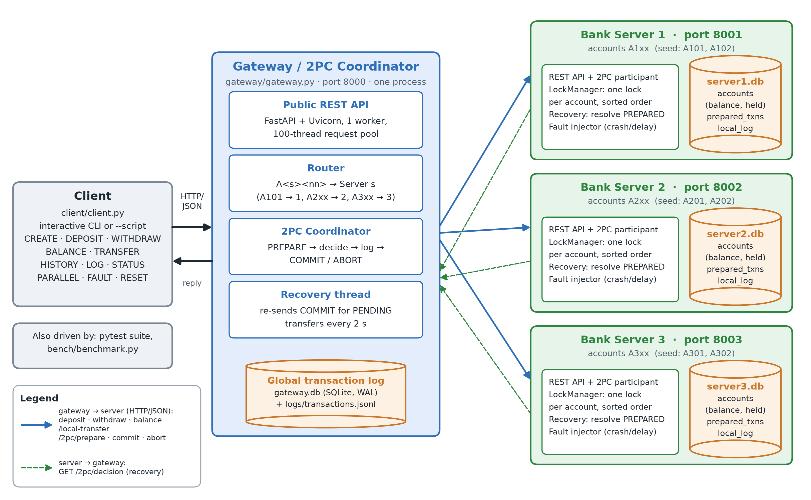
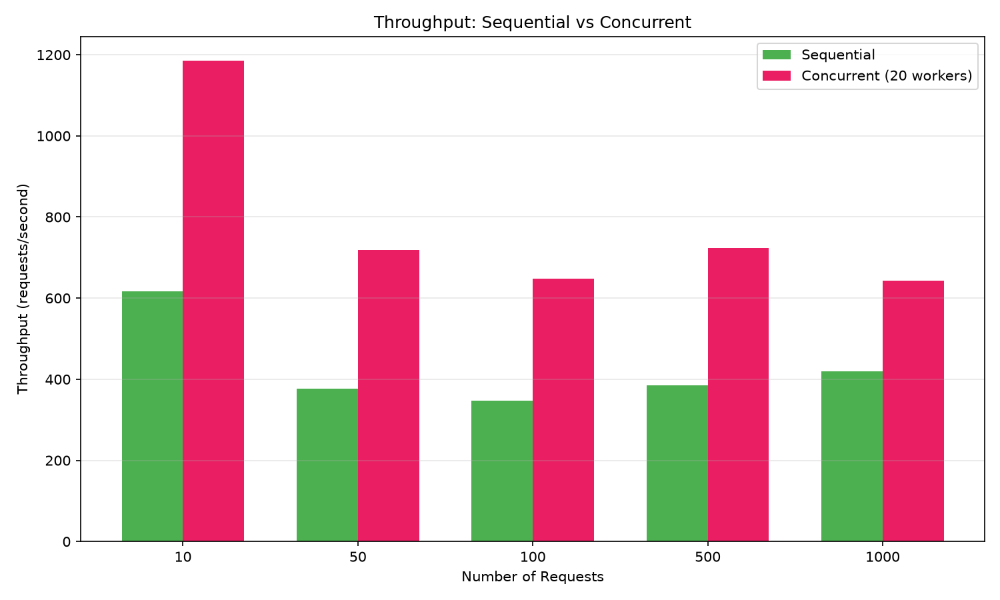
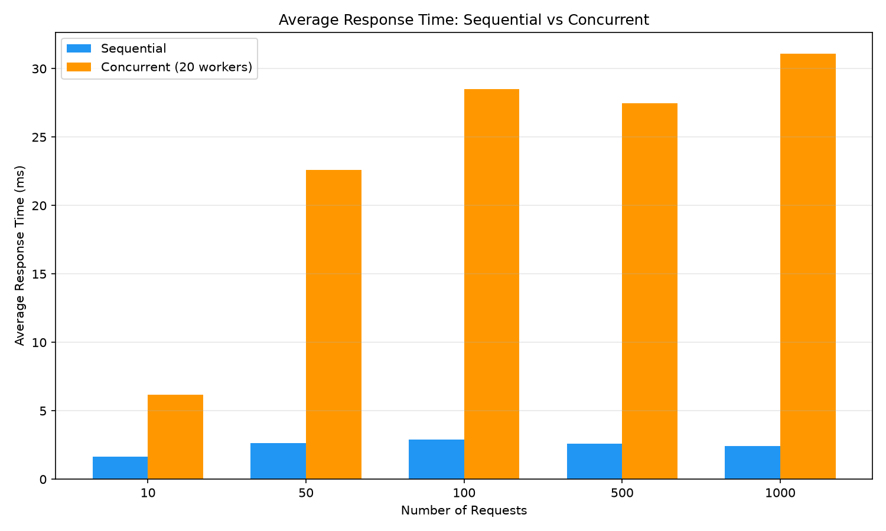
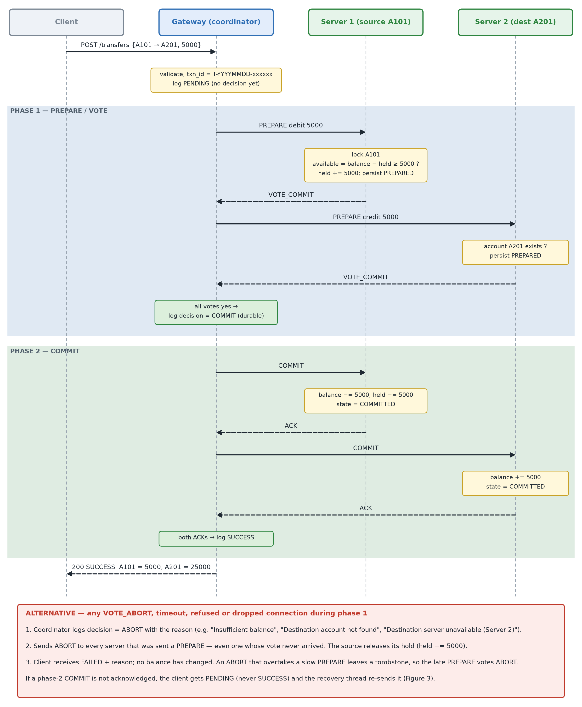
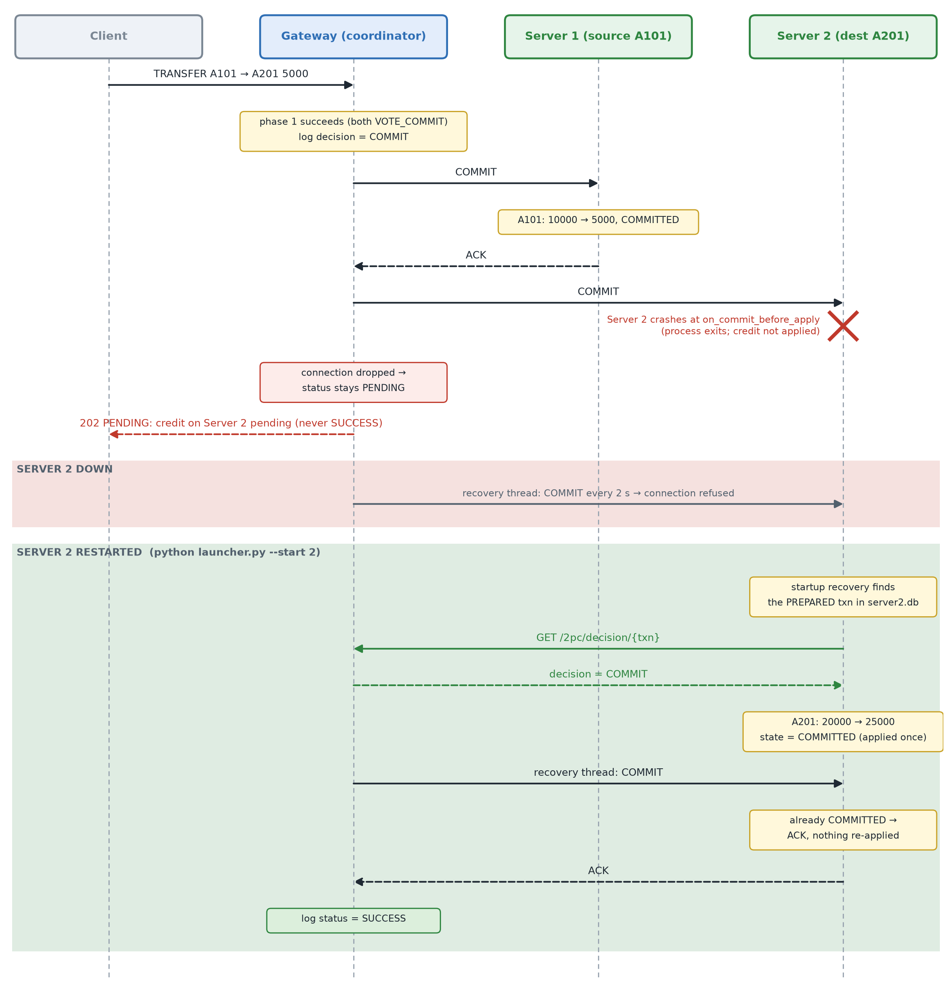
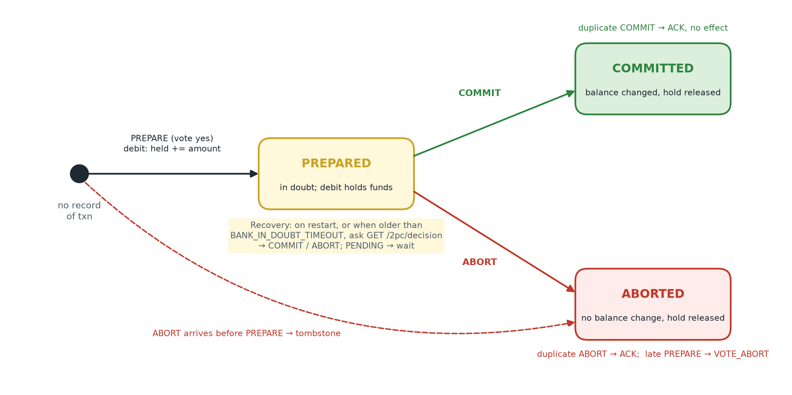

# Distributed Bank Transaction System

A distributed banking system in Python. A client talks to a gateway, and the gateway routes requests to three bank servers. Accounts are spread across the servers, so a transfer can involve accounts on two different servers. Cross-server transfers use **two-phase commit (2PC)**, which means money is never debited from one account without being credited to the other.

Each component runs as its own process and they communicate with **REST over HTTP** (FastAPI + Uvicorn, httpx). Each bank server stores its data in its own SQLite database.



## Features

- **Operations:** `CREATE`, `DEPOSIT`, `WITHDRAW`, `BALANCE`, `TRANSFER`, `HISTORY`, `LOG`, `STATUS`
- **Account-to-server mapping:** an account ID `A<s><nn>` lives on server `s` (A1xx → Server 1, A2xx → Server 2, A3xx → Server 3)
- **Atomic distributed transfers:** the gateway acts as the 2PC coordinator (PREPARE → decide → log → COMMIT/ABORT)
- **Concurrency control:** a thread pool handles requests, with one lock per account. Locks are taken in sorted order, so two transfers cannot deadlock.
- **Failure handling:** fault injection can crash or delay a server at chosen points, and recovery runs on restart. A transfer that has not finished is reported as `PENDING` or `FAILED`, never as `SUCCESS`.
- **Transaction log:** each transaction is recorded with its ID, source, destination, amount, timestamp, status and failure reason
- **Tests and benchmarks:** 47 automated tests, plus a benchmark that compares sequential and concurrent execution

## Repository layout

```
.
├── distributed-bank-system/   # source code (see its README for the full run guide)
│   ├── client/                # interactive CLI client / script runner
│   ├── gateway/               # gateway, router, 2PC coordinator, transaction log, recovery
│   ├── server/                # bank server, SQLite store, lock manager, fault injection, recovery
│   ├── common/                # shared models, errors, time utilities
│   ├── bench/                 # benchmark and plotting scripts
│   ├── scripts/               # test report generator
│   ├── config.py
│   └── launcher.py            # starts / stops / kills servers and the gateway
├── test-cases/                # pytest suite + client scenario scripts
├── results/                   # test results (Markdown report, JUnit XML, pytest output)
├── performance-results/       # benchmark CSV, table and graphs
└── docs/                      # project report and architecture diagrams
```

## Quick start

Requires Python 3.10+.

```bash
cd distributed-bank-system
python3 -m venv .venv
source .venv/bin/activate          # Windows: .venv\Scripts\activate
pip install -r requirements.txt

# terminal 1: start the 3 bank servers and the gateway with seed accounts
python launcher.py --fresh

# terminal 2: start the client
python client/client.py
```

Example session:

```
ACCOUNTS
BALANCE A101
DEPOSIT A101 2000
WITHDRAW A101 3000
TRANSFER A101 A201 5000                                # cross-server transfer (2PC)
TRANSFER A101 A999 5000                                # FAILED: Destination account not found
PARALLEL WITHDRAW A102 8000 ; WITHDRAW A102 8000       # exactly one succeeds
LOG
```

The full run guide is in [distributed-bank-system/README.md](distributed-bank-system/README.md). It covers seed accounts, failure simulation, the transaction log, tests, benchmarks and configuration.

## Running tests

```bash
cd distributed-bank-system
pytest ../test-cases -q
```

The tests start their own cluster on ports 9000–9003. All **47 tests pass**; see [results/test_results.md](results/test_results.md) for the results of each test case.

| # | Test case | Result |
|---|-----------|--------|
| 1 | Deposit | ✅ |
| 2 | Withdrawal | ✅ |
| 3 | Insufficient balance | ✅ |
| 4 | Successful distributed transfer | ✅ |
| 5 | Concurrent transfers | ✅ |
| 6 | Concurrent withdrawal | ✅ |
| 7 | Server failure (before, during PREPARE, during COMMIT, destination unavailable) | ✅ |
| 8 | Invalid account | ✅ |

## Performance

Setup: 30 accounts, a mix of 30% deposit / 20% withdraw / 20% balance / 30% transfer. Each value is the mean of 3 runs. The concurrent runs use 20 workers.

| Requests | Sequential throughput (req/s) | Concurrent throughput (req/s) | Sequential avg (ms) | Concurrent avg (ms) |
|---------:|------:|------:|-----:|------:|
| 10   | 616.6 | 1186.1 | 1.63 | 6.18 |
| 50   | 376.0 | 717.9  | 2.66 | 22.60 |
| 100  | 347.0 | 648.3  | 2.88 | 28.51 |
| 500  | 384.7 | 723.9  | 2.61 | 27.48 |
| 1000 | 419.4 | 642.3  | 2.42 | 31.11 |

All runs finished with 0 failed requests and balances that stayed consistent. The full table is in [performance-results/perf_table.md](performance-results/perf_table.md).

<p>
  
  
</p>

## Design diagrams

| Two-phase commit | Crash during COMMIT and recovery |
|---|---|
|  |  |



## Documentation

- [Project report](docs/Distributed_Bank_Report.docx)
- [System architecture diagrams](docs/System_Architecture_Diagrams.docx)

